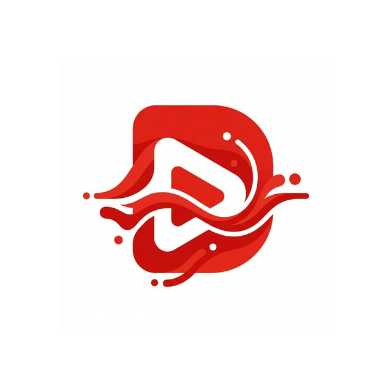
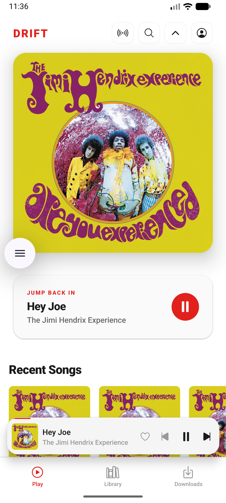
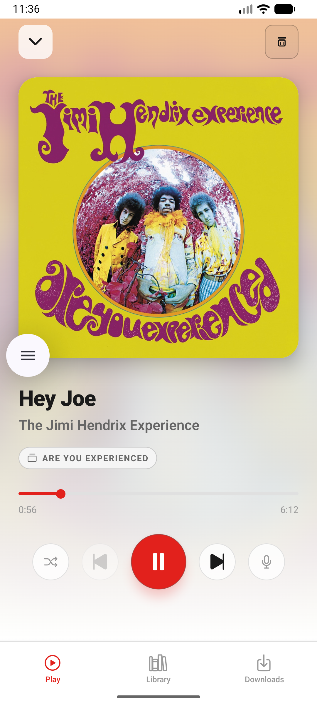
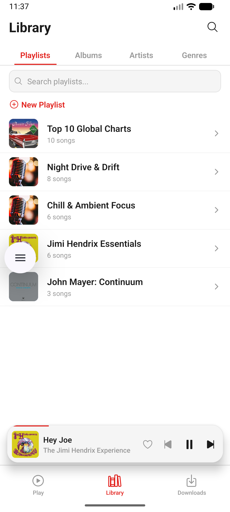
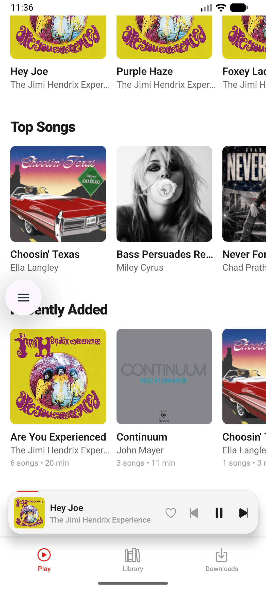
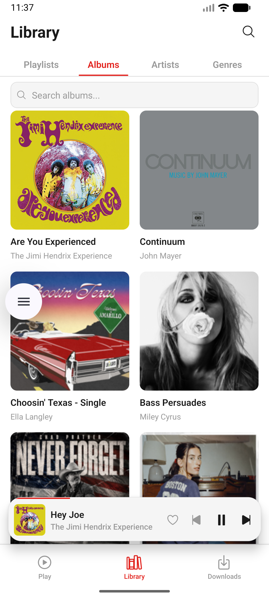
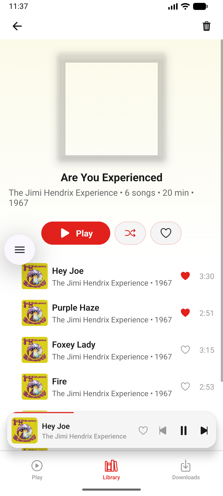
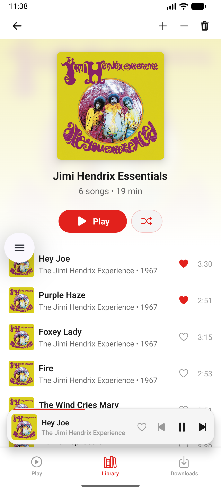

<p align="center">
  
</p>

<h1 align="center">Drift</h1>

Kotlin Multiplatform music player for Android and iOS, with support for
Subsonic-compatible servers and music stored on your device.

Drift does not require a Drift account or server. Connect your own Subsonic or
OpenSubsonic server, or choose device-only mode to play local music.

This project is independent and is not affiliated with Feishin, Subsonic,
Navidrome, or any music service.

## Screenshots

| Home | Now Playing | Library / Playlists |
|------|-------------|---------------------|
|  |  |  |

| Recently Added | Albums | Album Detail | Playlist |
|----------------|--------|--------------|----------|
|  |  |  |  |

## Build

Android debug APK (JDK 17 and Android SDK 36):

```sh
./gradlew :androidApp:assembleDebug
```

Run shared tests:

```sh
./gradlew :shared:allTests
```

For iOS, use macOS with Xcode 16 or later:

```sh
cd iosApp && xcodegen
```

Then open `iosApp.xcodeproj` in Xcode. The Android application ID is
`com.drift.app`; installing a build signed with the same key upgrades the
existing app.

## Music sources

- **Subsonic / OpenSubsonic:** connect a server you choose. Drift uses standard
  Subsonic endpoints and OpenSubsonic lyrics support.
- **On-device music:** scan and play audio available on the phone. Device-only
  mode works without connecting to a server; device music can also be shown
  alongside server music.
- **Downloads:** manage offline server tracks in the app.

On-device tracks use app-managed stars, play counts, and playlists; Drift does
not modify the music files.

## Not done yet / known gaps

- **CarPlay** (requires Apple entitlement and templates). Android Auto is implemented.
- Queue drag-to-reorder (the queue supports tap-to-jump and remove).
- Artwork-based dominant-colour gradients (currently uses a deterministic colour per id).
- Disk cache for Home sections (memory cache only; Downloads and device music work offline).
- Wi-Fi-only download toggle and download-over-metered handling.
- Automated player tests.
- iOS device music needs on-device testing; DRM and cloud tracks are skipped.
